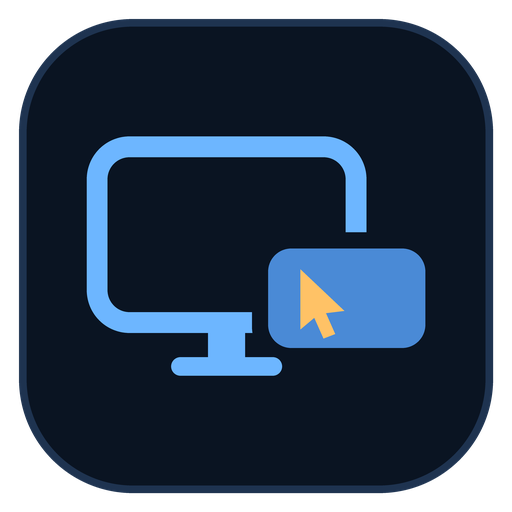
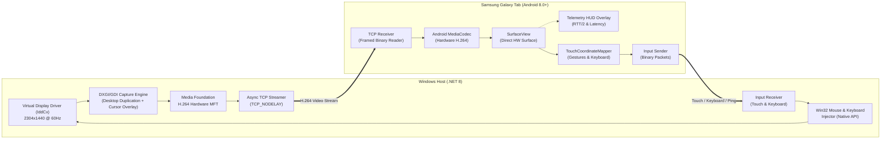

<p align="center">
  <!-- LOGO_PLACEHOLDER -->
  
  <h1 align="center">Areas — SecondScreen</h1>
  <p align="center">
    <strong>Second monitor solution for Windows using Android tablets.</strong>
  </p>
  <p align="center">
    <a href="https://dotnet.microsoft.com/"></a>
    <a href="https://kotlinlang.org/"></a>
    <a href="https://developer.android.com/"></a>
    <a href="https://github.com/skyfall3215/areas/blob/main/LICENSE"></a>
    
  </p>
</p>

---

## 📌 Overview

**Areas (SecondScreen)** is an open-source, hardware-accelerated remote display and input solution that transforms your Samsung Galaxy Tab (or any modern Android tablet) into a **true, independent extended monitor** for your Windows PC or laptop.

Unlike simple screen mirroring apps, Areas integrates Windows Indirect Display Driver (IddCx) technology to create a dedicated secondary monitor at your tablet's native resolution (`2304x1440` @ 60/90Hz). It streams desktop frames while seamlessly bridging touch gestures, mouse emulation, and virtual keyboard input back to Windows over a custom binary protocol.

---

## ✨ Key Features

- ⚡ **Hardware-Accelerated Video Pipeline:**
  - **Host (PC):** Windows Media Foundation (MFT) hardware H.264 CBR encoder, 0 B-frames, DXGI Desktop Duplication capture (with GDI fallback), `TCP_NODELAY`.
  - **Client (Tablet):** Hardware-accelerated Android `MediaCodec` NAL parser with direct rendering to `SurfaceView`.
- 🖥️ **True Second Display (Virtual Display & Extend Desktop):**
  - Secondary virtual monitor powered by Windows IddCx (`MttVDD`).
  - Supports native tablet resolutions and aspect ratios (e.g., `2304x1440` 16:10).
  - Automatically invokes Windows `ExtendDesktop` topology upon client connection.
- 🖱️ **Cursor Overlay:**
  - Real-time native Windows mouse pointer rendering directly onto the video buffer (with software cursor fallback).
- 🖐️ **Windows-Like Touch Gestures & Mouse Emulation:**
  - **Tap:** Left mouse click.
  - **Long Press:** Right click (context menu).
  - **Drag / Pan:** Window dragging, text selection, and mouse movement.
  - **Two-Finger Tap:** Double click.
  - **Two-Finger Scroll:** Smooth vertical and horizontal mouse wheel scrolling.
- ⌨️ **Moonlight-Style Virtual Keyboard:**
  - On-screen floating toggle button at the bottom right corner.
  - Type into any Windows text field from the tablet with Unicode text input and key support (Backspace, Enter, Tab, Esc, Space).
- 🌐 **Zero-Config Multi-Transport Modes:**
  1. **USB-C (ADB Reverse):** Maximum bandwidth, zero packet loss, completely immune to Wi-Fi interference.
  2. **Wi-Fi LAN & Auto-Discovery:** Instant one-click connection via UDP broadcast discovery (`port 27184`).
  3. **Windows Mobile Hotspot:** Fallback mode for university dorms, hotels, and enterprise networks with Wi-Fi Client Isolation (opens Windows Mobile Hotspot settings and connects via `192.168.137.1`).
- 📊 **Real-Time Telemetry HUD:**
  - Live on-screen performance stats: FPS, Bitrate, Capture time, Encode time, Network latency (RTT/2), Decode time, Total Estimated Latency, and frame drop/IDR counters.

---

## 🏗️ Architecture



---

## 🚀 Getting Started

### Prerequisites

- **Windows PC:**
  - Windows 10 (Build 19041+) or Windows 11 (64-bit).
  - [.NET 8.0 SDK](https://dotnet.microsoft.com/download/dotnet/8.0).
  - GPU with hardware H.264 encoding support (Intel UHD/Iris, NVIDIA GeForce, or AMD Radeon).
  - Android Debug Bridge (ADB) — recommended for USB cable mode.
- **Android Tablet:**
  - Android 8.0 (API 26) or higher (optimized for Samsung Galaxy Tab series).
  - Hardware H.264 decoder (Snapdragon or Exynos SoC).

---

### Installation & Usage

#### 1. Install Virtual Display Driver (One-Time Setup)
To enable Windows to recognize the tablet as an independent second monitor rather than mirroring, install the Windows IddCx Indirect Display Driver (`MttVDD` / Virtual Display Driver) as Administrator before running the host.

#### 2. Start Windows Host
From PowerShell / Terminal:
```bash
dotnet run --project windows-host/src/SecondScreen.App -c Release
```

The host automatically:
- Sets up the USB ADB reverse tunnel (`adb reverse tcp:27183`).
- Detects Wi-Fi LAN and Mobile Hotspot interfaces.
- Starts broadcasting UDP discovery beacons on port `27184`.
- Automatically calls `ExtendDesktop` to activate the secondary display when the tablet connects.

#### 3. Install & Launch Android Client
1. Open the project in Android Studio or install the APK via ADB:
   ```bash
   adb install android-client/app/build/outputs/apk/debug/app-debug.apk
   ```
2. Open **Areas** on your tablet:
   - If connected via USB cable, tap **USB Connection**.
   - If connected over Wi-Fi, select the auto-discovered PC from the list.

---

## 📡 Binary Protocol Specification

Areas communicates over an efficient, big-endian framed binary protocol designed for minimal overhead:

| Packet Type | ID | Direction | Description |
| :--- | :---: | :---: | :--- |
| `HELLO` | `0x01` | Tablet ➔ PC | Device model, native resolution (`2304x1440`), max refresh rate, and preferred bitrate. |
| `HELLO_ACK` | `0x02` | PC ➔ Tablet | Stream confirmation parameters (width, height, FPS, allocated bitrate). |
| `VIDEO_CONFIG` | `0x10` | PC ➔ Tablet | H.264 SPS and PPS parameter sets (MediaCodec initializer). |
| `VIDEO_FRAME` | `0x11` | PC ➔ Tablet | H.264 NAL units (I-Frame / P-Frame), timestamp, and frame sequence number. |
| `KEYFRAME_REQ` | `0x12` | Tablet ➔ PC | Instant IDR keyframe request triggered upon decode queue drop or decoder error. |
| `TOUCH_EVENT` | `0x20` | Tablet ➔ PC | Touch/mouse actions (click, double-click, right-click, move, scroll) with normalized coords (`0..65535`). |
| `KEYBOARD_EVENT` | `0x21` | Tablet ➔ PC | Virtual keycode, ASCII/Unicode character, and modifier flags. |
| `PING / PONG` | `0x30 / 0x31` | Bi-directional | Round-trip time (RTT) latency tracking. |
| `ERROR` | `0xF0` | Bi-directional | Error code and diagnostic message. |
| `DISCONNECT` | `0xFF` | Bi-directional | Graceful session termination. |

---

## 🧪 Testing

Run the full xUnit test suite across the solution:
```bash
dotnet test windows-host/WindowsHost.sln
```
*All 44 unit and integration tests (Networking, Encoding, Protocol serialization, Display enumeration, Screen capture, Touch coordinate mapping, and Dashboard/server lifecycle) pass with zero errors.*

---

## 🗺️ Roadmap & Milestones

- [x] **Stage 1: Core USB Streaming** (ADB reverse, H.264 Media Foundation & MediaCodec, SurfaceView).
- [x] **Stage 2: Latency Measurement & HUD** (Ping/Pong RTT, Live Telemetry Overlay, 60 FPS pipeline).
- [x] **Stage 3: Wi-Fi LAN & Discovery** (UDP Auto-discovery, Client Isolation detection, Keyframe recovery).
- [x] **Stage 4A: Mobile Hotspot & Bitrate Presets** (Dorm/Campus Wi-Fi support, user-selectable CBR bitrate presets).
- [x] **Stage 5: Input & Virtual Keyboard** (Touch-to-mouse gestures, scroll emulation, on-screen virtual keyboard).
- [x] **Stage 6: Virtual Display & Extended Desktop** (IddCx driver integration, multi-monitor topology, cursor overlay).

---

## 📄 License

This project is licensed under the [GNU General Public License v3.0 (GPLv3)](LICENSE). Feel free to use, modify, and distribute it under the terms of copyleft freedom.
