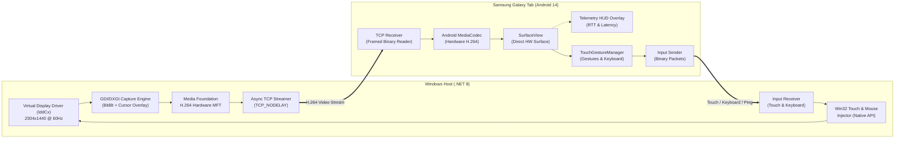

<p align="center">
  <!-- LOGO_PLACEHOLDER -->
  
  <h1 align="center">Areas — SecondScreen</h1>
  <p align="center">
    <strong>Ultra-low-latency (< 25 ms), high-performance second monitor solution for Windows using Android tablets.</strong>
  </p>
  <p align="center">
    <a href="https://dotnet.microsoft.com/"></a>
    <a href="https://kotlinlang.org/"></a>
    <a href="https://developer.android.com/"></a>
    <a href="https://github.com/skyfall3215/areas/blob/main/LICENSE"></a>
    
    
  </p>
</p>

---

## 📌 Overview

**Areas (SecondScreen)** is an open-source, ultra-low-latency, hardware-accelerated remote display and input solution that transforms your Samsung Galaxy Tab (or any modern Android tablet) into a **true, independent extended monitor** for your Windows PC or laptop.

Unlike simple screen mirroring apps, Areas integrates Windows Indirect Display Driver (IddCx) technology to create a dedicated secondary monitor at your tablet's native resolution (`2304x1440` @ 60/90Hz). It streams desktop frames with sub-frame encoding latency while seamlessly bridging multi-touch gestures, mouse emulation, and virtual keyboard input back to Windows over a custom binary protocol.

---

## ✨ Key Features

- ⚡ **Ultra-Low Latency (15–25 ms End-to-End):**
  - **Host (PC):** Windows Media Foundation (MFT) hardware H.264 CBR encoder, 0 B-frames, sub-millisecond GDI/DIB capture, `TCP_NODELAY`.
  - **Client (Tablet):** Hardware-accelerated Android `MediaCodec` NAL parser with zero-copy direct rendering to `SurfaceView`.
- 🖥️ **True Second Display (Virtual Display & Extend Desktop):**
  - Native virtual monitor powered by Windows IddCx (`DISPLAY2`).
  - Supports native tablet resolutions and aspect ratios (e.g., `2304x1440` 16:10).
  - Automatically invokes Windows `ExtendDesktop` topology upon client connection.
- 🖱️ **High-DPI Software Cursor Overlay:**
  - Real-time mouse pointer rendering directly onto the video buffer with sub-millisecond precision.
  - Automatically scales (1.5x / High-DPI) with crisp black-and-white borders for flawless visibility on high-resolution displays.
- 🖐️ **Windows-Like Touch Gestures & Mouse Emulation:**
  - **Tap:** Left mouse click.
  - **Long Press:** Right click (context menu).
  - **Drag / Pan:** Window dragging, text selection, and mouse movement.
  - **Two-Finger Tap:** Quick right click.
  - **Two-Finger Scroll:** Smooth vertical and horizontal mouse wheel scrolling.
  - **Pinch-to-Zoom:** Emulates `Ctrl + Mouse Wheel` for zooming in browsers and documents.
- ⌨️ **Moonlight-Style Virtual Keyboard:**
  - On-screen floating toggle button at the bottom right corner.
  - Type into any Windows text field from the tablet with full modifier support (Ctrl, Alt, Shift, Backspace, Enter, Esc, Navigation keys).
- 🌐 **Zero-Config Multi-Transport Modes:**
  1. **USB-C (ADB Reverse):** Maximum bandwidth, zero packet loss, completely immune to Wi-Fi interference.
  2. **Wi-Fi LAN & Auto-Discovery:** Instant one-click connection via UDP broadcast discovery (`port 27184`).
  3. **Windows Mobile Hotspot:** Dedicated 1-click fallback mode for university dorms, hotels, and enterprise networks with Wi-Fi Client Isolation.
- 📊 **Real-Time Telemetry HUD:**
  - Live on-screen performance stats: FPS, Bitrate, Encode time, Network RTT, Decode time, and Total Estimated Latency.

---

## 🏗️ Architecture



---

## 📂 Repository Structure

```text
Areas/
├── android-client/                  # Android Client App (Kotlin / Jetpack Compose)
│   ├── app/src/main/java/com/secondscreen/client/
│   │   ├── connection/              # TCP client, network manager, state machine
│   │   ├── discovery/               # UDP auto-discovery listener
│   │   ├── input/                   # TouchGestureManager, virtual keyboard & input mapping
│   │   ├── protocol/                # Binary packet serialization & parsing
│   │   ├── telemetry/               # Live latency tracker & HUD state
│   │   ├── ui/                      # Jetpack Compose UI, video SurfaceView
│   │   └── video/                   # MediaCodec hardware H.264 video player
│   └── build.gradle.kts
│
├── windows-host/                    # Windows Host Application (.NET 8 / C#)
│   ├── src/
│   │   ├── SecondScreen.App/        # Host entry point, orchestrator & CLI
│   │   ├── SecondScreen.Core/       # Shared models, constants & configuration
│   │   ├── SecondScreen.Display/    # Windows display topology manager (Extend/Internal)
│   │   ├── SecondScreen.Input/      # Win32 touch & mouse injector (Native API)
│   │   ├── SecondScreen.Media/      # GDI/DXGI screen capture, cursor overlay, MFT H.264 encoder
│   │   └── SecondScreen.Network/    # TCP server, UDP beacon broadcaster, hotspot manager
│   ├── tests/SecondScreen.Tests/    # XUnit unit & integration test suite (37 tests)
│   └── WindowsHost.sln
│
├── docs/                            # Documentation, protocol specifications & roadmap
│   ├── assets/                      # Logos and screenshots
│   ├── PLAN.md                      # Comprehensive phased implementation plan
│   └── PROTOCOL.md                  # Binary communication protocol specification
│
├── install-virtual-display.cmd      # One-click virtual display driver installer
├── uninstall-virtual-display.cmd    # Virtual display driver uninstaller
├── run-host.cmd                     # Windows Host launcher batch script
└── run-host.ps1                     # Windows Host launcher PowerShell script
```

---

## 🚀 Getting Started

### Prerequisites

- **Windows PC:**
  - Windows 10 (Build 19041+) or Windows 11 (64-bit).
  - [.NET 8.0 SDK](https://dotnet.microsoft.com/download/dotnet/8.0).
  - GPU with hardware H.264 encoding support (Intel UHD/Iris, NVIDIA GeForce, or AMD Radeon).
  - Android Debug Bridge (ADB) — recommended for USB cable mode.
- **Android Tablet:**
  - Android 10 (API 29) or higher (optimized for Samsung Galaxy Tab series).
  - Hardware H.264 decoder (Snapdragon or Exynos SoC).

---

### Installation & Usage

#### 1. Install Virtual Display Driver (One-Time Setup)
To enable Windows to recognize the tablet as an independent second monitor rather than mirroring:
```cmd
:: Run as Administrator:
install-virtual-display.cmd
```
*This installs the lightweight Windows IddCx Indirect Display Driver and activates the secondary display (`2304x1440`).*

#### 2. Start Windows Host
```cmd
run-host.cmd
```
or from PowerShell / Terminal:
```bash
dotnet run --project windows-host/src/SecondScreen.App -c Release
```

The host automatically:
- Sets up the USB ADB reverse tunnel (`adb reverse tcp:27183`).
- Detects Wi-Fi LAN and Mobile Hotspot interfaces.
- Starts broadcasting UDP discovery beacons on port `27184`.
- Automatically calls `ExtendDesktop` to activate the secondary display when the tablet connects.

#### 3. Install & Launch Android Client
1. Open the project in Android Studio or install the APK via ADB:
   ```bash
   adb install android-client/app/build/outputs/apk/debug/app-debug.apk
   ```
2. Open **Areas** on your tablet:
   - If connected via USB cable, tap **USB Connection**.
   - If connected over Wi-Fi, select the auto-discovered PC from the list.

---

## 📡 Binary Protocol Specification

Areas communicates over an efficient, big-endian framed binary protocol designed for minimal overhead and zero GC pressure:

| Packet Type | ID | Direction | Description |
| :--- | :---: | :---: | :--- |
| `HELLO` | `0x01` | Tablet ➔ PC | Device model, native resolution (`2304x1440`), max refresh rate, and preferred bitrate. |
| `HELLO_ACK` | `0x02` | PC ➔ Tablet | Stream confirmation parameters (width, height, FPS, allocated bitrate). |
| `VIDEO_CONFIG` | `0x03` | PC ➔ Tablet | H.264 SPS and PPS parameter sets (MediaCodec initializer). |
| `VIDEO_FRAME` | `0x04` | PC ➔ Tablet | H.264 NAL units (I-Frame / P-Frame), timestamp, and frame sequence number. |
| `TOUCH` | `0x05` | Tablet ➔ PC | Multi-touch contact points (Pointer ID, Action: DOWN/MOVE/UP, Normalized coords: `0..65535`). |
| `KEYBOARD` | `0x06` | Tablet ➔ PC | Virtual keycode, ASCII/Unicode character, and modifier flags (Ctrl, Alt, Shift). |
| `PING / PONG` | `0x07 / 0x08` | Bi-directional | Sub-millisecond round-trip time (RTT) latency tracking. |
| `KEYFRAME_REQ` | `0x09` | Tablet ➔ PC | Instant IDR keyframe request triggered upon packet loss or decoder sync loss. |

> For complete payload definitions and packet structures, refer to [`docs/PROTOCOL.md`](docs/PROTOCOL.md).

---

## 🧪 Testing

Run the full xUnit test suite across the solution:
```bash
dotnet test windows-host/WindowsHost.sln
```
*All 37 unit and integration tests (Networking, Encoding, Protocol serialization, Display enumeration, Virtual display, and Cursor rendering) pass with zero errors.*

---

## 🗺️ Roadmap & Milestones

- [x] **Stage 1: Core USB Streaming** (ADB reverse, H.264 Media Foundation & MediaCodec, SurfaceView).
- [x] **Stage 2: Latency Measurement & HUD** (Ping/Pong RTT, Live Telemetry Overlay, 60 FPS pipeline).
- [x] **Stage 3: Wi-Fi LAN & Discovery** (UDP Auto-discovery, Client Isolation detection, Keyframe recovery).
- [x] **Stage 4A: Mobile Hotspot & Adaptive Bitrate** (Dorm/Campus Wi-Fi support, network congestion control).
- [x] **Stage 5: Input & Virtual Keyboard** (Windows touch gestures, mouse wheel emulation, Moonlight on-screen keyboard).
- [x] **Stage 6: Virtual Display & Extended Desktop** (IddCx driver integration, multi-monitor topology, High-DPI cursor overlay).

---

## 📄 License

This project is licensed under the [MIT License](LICENSE). Feel free to use, modify, and distribute it freely.
