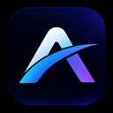
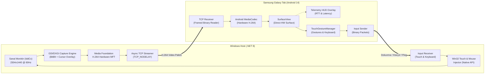

<p align="center">
  <!-- LOGO_PLACEHOLDER -->
  
  <h1 align="center">Areas — SecondScreen</h1>
  <p align="center">
    <strong>Windows dizüstü ve masaüstü bilgisayarlar için ultra düşük gecikmeli (< 25 ms) Android ikinci ekran çözümü.</strong>
  </p>
  <p align="center">
    <a href="https://dotnet.microsoft.com/"></a>
    <a href="https://kotlinlang.org/"></a>
    <a href="https://developer.android.com/"></a>
    <a href="https://github.com/skyfall3215/areas/blob/main/LICENSE"></a>
    
    
  </p>
</p>

---

## 📌 Proje Hakkında

**Areas (SecondScreen)**, bir Samsung Galaxy Tab (veya herhangi bir modern Android tablet) cihazını Windows bilgisayarınız için **tam bağımsız, genişletilmiş (Extended) ikinci bir monitör** haline getiren açık kaynaklı, yüksek performanslı ve donanım hızlandırmalı bir ekran paylaşım ve uzaktan girdi sistemidir.

Yalnızca ekranı klonlamakla kalmaz; Windows IddCx sanal monitör sürücüsü entegrasyonu sayesinde tabletin yerel çözünürlüğünde (`2304x1440` vb.) ayrı bir masaüstü alanı açar. Windows çoklu dokunma hareketlerini, fare emülasyonunu ve sanal klavyeyi düşük gecikmeli bir ikili (binary) protokol üzerinden taşır.

---

## ✨ Temel Özellikler

- ⚡ **Ultra Düşük Gecikme (15–25 ms):**
  - **Host (PC):** Windows Media Foundation (MFT) donanımsal H.264 CBR kodlayıcı, sıfır B-frame gecikmesi, `TCP_NODELAY`.
  - **Client (Tablet):** Android donanımsal `MediaCodec` NAL parser ve doğrudan `SurfaceView` render mimarisi.
- 🖥️ **Gerçek İkinci Ekran (Virtual Display & Extend):**
  - Windows IddCx sanal ekran sürücüsü ile bağımsız 2. ekran (`DISPLAY2`).
  - Tabletin doğal ekran en-boy oranına (`2304x1440 @ 60/90Hz`) özel çözünürlük desteği.
  - Bağlantı anında otomatik `ExtendDesktop` masaüstü genişletme.
- 🖱️ **Yüksek Çözünürlüklü Fare İmleci (High-DPI Cursor Overlay):**
  - Fare 2. ekrana geçtiğinde donanımsal video akışı üzerine doğrudan 1.5x High-DPI Windows ok imleci bindirilir (Moonlight / Parsec tarzı doğrudan piksel işleme).
- 🖐️ **Windows Benzeri Dokunmatik Hareketler ve Fare Emülasyonu:**
  - **Tek Dokunuş:** Sol tıklama.
  - **Uzun Basma:** Sağ tıklama (bağlam menüsü).
  - **Sürükleme:** Pencereleri taşıma, seçim yapma ve fare hareketi.
  - **İki Parmakla Dokunma:** Hızlı sağ tık.
  - **İki Parmakla Kaydırma:** Dikey ve yatay pürüzsüz fare tekerleği (Mouse Wheel).
  - **Kıstırma (Pinch-to-Zoom):** `Ctrl + Mouse Wheel` ile yakınlaştırma / uzaklaştırma.
- ⌨️ **Moonlight Tarzı Sanal Klavye:**
  - Ekranın sağ alt köşesinde açılır/kapanır klavye butonu.
  - Windows metin alanlarına odaklanıldığında doğrudan tablet üzerinden Türkçe/İngilizce yazma, fonksiyon ve modifiye tuşları (Ctrl, Alt, Shift, Backspace, Enter, Esc).
- 🌐 **Her Ortama Uygun 3 Taşıma Modu:**
  1. **USB-C Kablo (`adb reverse`):** Sıfır paket kaybı, maksimum bant genişliği, Wi-Fi parazitlerinden arındırılmış en kararlı mod.
  2. **Wi-Fi LAN & Otomatik Keşif:** UDP Keşif yayını (`27184`) ile tek tıkla otomatik bağlanma.
  3. **Windows Mobil Etkin Nokta (Hotspot):** İstemci izolasyonu (Client Isolation) bulunan yurt, otel ve okul ağlarında tek tıkla doğrudan bağlantı.
- 📊 **Canlı Telemetri HUD Paneli:**
  - Anlık FPS, Bitrate, Kodlama süresi, Ağ RTT/2 gecikmesi, Çözme süresi ve Tahmini Toplam Gecikme ekranı.

---

## 🏗️ Sistem Mimarisi



---

## 📂 Proje Yapısı

```text
Areas/
├── android-client/                  # Android İstemci Uygulaması (Kotlin / Jetpack Compose)
│   ├── app/src/main/java/com/secondscreen/client/
│   │   ├── connection/              # TCP İstemcisi, Ağ yöneticisi, Bağlantı durumu
│   │   ├── discovery/               # UDP Otomatik Keşif Dinleyicisi
│   │   ├── input/                   # TouchGestureManager, Sanal Klavye ve Girdi Haritalama
│   │   ├── protocol/                # İkili (Binary) Paket Serileştirme & Çözümleme
│   │   ├── telemetry/               # Canlı Gecikme Ölçümü ve HUD Takipçisi
│   │   ├── ui/                      # Jetpack Compose Arayüzü, Video SurfaceView
│   │   └── video/                   # MediaCodec Donanımsal H.264 Video Oynatıcı
│   └── build.gradle.kts
│
├── windows-host/                    # Windows Sunucu Uygulaması (.NET 8 / C#)
│   ├── src/
│   │   ├── SecondScreen.App/        # Host Konsol / UI Başlatıcısı ve Orkestratör
│   │   ├── SecondScreen.Core/       # Ortak Tipler ve Yapılandırma
│   │   ├── SecondScreen.Display/    # Windows Çoklu Monitör ve Topology Yönetimi (Extend/Internal)
│   │   ├── SecondScreen.Input/      # Win32 Çoklu Dokunma ve Fare Enjeksiyonu
│   │   ├── SecondScreen.Media/      # GDI/DXGI Ekran Yakalama, Cursor Çizimi, MFT H.264 Kodlayıcı
│   │   └── SecondScreen.Network/    # TCP Sunucu, UDP Keşif Yayını, Hotspot Algılama
│   ├── tests/SecondScreen.Tests/    # XUnit Birim ve Entegrasyon Testleri (37 test)
│   └── WindowsHost.sln
│
├── docs/                            # Mimari dokümantasyon, protokol şartnameleri ve planlar
│   ├── assets/                      # Logo ve ekran görüntüleri
│   ├── PLAN.md                      # Aşama aşama geliştirme planı ve yol haritası
│   └── PROTOCOL.md                  # İkili (Binary) haberleşme protokolü detayları
│
├── install-virtual-display.cmd      # Sanal ekran sürücüsü tek tık kurulum betiği
├── uninstall-virtual-display.cmd    # Sanal ekran sürücüsü kaldırma betiği
├── run-host.cmd                     # Windows Host başlatma komut dosyası
└── run-host.ps1                     # Windows Host başlatma PowerShell betiği
```

---

## 🚀 Başlarken

### Gereksinimler

- **Windows PC:**
  - Windows 10 (Build 19041+) veya Windows 11 (64-bit).
  - [.NET 8.0 SDK](https://dotnet.microsoft.com/download/dotnet/8.0).
  - H.264 donanım kodlama destekli ekran kartı (Intel UHD/Iris, NVIDIA GeForce veya AMD Radeon).
  - Android Debug Bridge (ADB) — USB modu için önerilir.
- **Android Tablet:**
  - Android 10 (API 29) veya üzeri (Samsung Galaxy Tab serisi ile optimize edilmiştir).
  - Donanımsal H.264 çözücü (Snapdragon / Exynos yonga setleri).

---

### Kurulum Adımları

#### 1. Sanal Ekran Sürücüsünü Kurun (Yalnızca İlk Seferde)
Masaüstünü kopyalamak yerine tableti ayrı bir 2. monitör olarak kullanmak için sürücüyü yükleyin:
```cmd
:: Yönetici olarak çalıştırın:
install-virtual-display.cmd
```
*Bu komut Windows IddCx sanal ekran sürücüsünü sisteme tanır ve `2304x1440` çözünürlüklü 2. monitörü oluşturur.*

#### 2. Windows Host Uygulamasını Başlatın
```cmd
run-host.cmd
```
veya terminalden:
```bash
dotnet run --project windows-host/src/SecondScreen.App -c Release
```

Host çalıştırıldığında:
- USB ADB tünelini (`adb reverse tcp:27183`) otomatik açar.
- Wi-Fi ve Hotspot IP adreslerini algılar.
- UDP üzerinden ağa anons yapar (`27184`).
- Tablet bağlandığında otomatik olarak masaüstünü 2. ekrana genişletir (`ExtendDesktop`).

#### 3. Android İstemciyi Kurun ve Çalıştırın
1. Projeyi Android Studio ile açın veya derlenmiş APK'yı yükleyin:
   ```bash
   adb install android-client/app/build/outputs/apk/debug/app-debug.apk
   ```
2. Tabletten **Areas** uygulamasını açın:
   - USB kablosu takılıysa **USB Bağlantısı** butonuna dokunun.
   - Wi-Fi üzerindeyse otomatik keşfedilen sunucuyu seçip bağlanın.

---

## 📡 Haberleşme Protokolü

Areas, minimum ağ yükü ve maksimum hız için özel bir ikili (binary) framed protokol kullanır:

| Mesaj Türü | ID | Yön | Açıklama |
| :--- | :---: | :---: | :--- |
| `HELLO` | `0x01` | Tablet ➔ PC | Cihaz modeli, çözünürlük (`2304x1440`), yenileme hızı ve istenen bitrate. |
| `HELLO_ACK` | `0x02` | PC ➔ Tablet | Onaylanan akış parametreleri (genişlik, yükseklik, FPS, bitrate). |
| `VIDEO_CONFIG` | `0x03` | PC ➔ Tablet | H.264 SPS ve PPS parametre setleri (Decoder başlatıcı). |
| `VIDEO_FRAME` | `0x04` | PC ➔ Tablet | H.264 NAL birimleri (I-Frame veya P-Frame), zaman damgası ve kare numarası. |
| `TOUCH` | `0x05` | Tablet ➔ PC | Çoklu dokunma noktaları (PointerId, Action: DOWN/MOVE/UP, Normalize Koordinatlar: `0..65535`). |
| `KEYBOARD` | `0x06` | Tablet ➔ PC | Tuş kodu, ASCII/Unicode karakteri ve modifiye tuş bayrakları (Ctrl, Alt, Shift). |
| `PING / PONG` | `0x07 / 0x08` | Çift Yönlü | Milisaniye altı RTT ağ gecikmesi ölçümü. |
| `KEYFRAME_REQ` | `0x09` | Tablet ➔ PC | Kare kaybında anında yeni IDR anahtar kare talebi. |

> Detaylı protokol özellikleri için [`docs/PROTOCOL.md`](docs/PROTOCOL.md) belgesini inceleyin.

---

## 🧪 Testler

Çözümdeki tüm birim ve entegrasyon testlerini çalıştırmak için:
```bash
dotnet test windows-host/WindowsHost.sln
```
*Tüm 37 test (Ağ, Kodlayıcı, Protokol serileştirme, Monitör numaralandırma, Sanal ekran ve İmleç işleme) başarıyla doğrulanmıştır.*

---

## 🗺️ Geliştirme Yol Haritası

- [x] **Aşama 1: Temel Çekirdek & USB Akışı** (ADB reverse, H.264 Media Foundation & MediaCodec, SurfaceView).
- [x] **Aşama 2: Gecikme Ölçümü & HUD** (Ping/Pong RTT, Canlı Telemetri Paneli, 60 FPS optimizasyonu).
- [x] **Aşama 3: Wi-Fi LAN & İstemci İzolasyonu** (UDP Discovery, Client Isolation uyarı sistemi, Keyframe koruması).
- [x] **Aşama 4A: Windows Hotspot & Dinamik Bitrate** (Yurt/Okul Wi-Fi desteği, adaptif kalite yönetimi).
- [x] **Aşama 5: Gelişmiş Girdi & Sanal Klavye** (Windows dokunma hareketleri, fare tekerleği, Moonlight klavye paneli).
- [x] **Aşama 6: Sanal Monitör & Genişletilmiş Masaüstü** (IddCx sürücüsü, çoklu ekran topolojisi, High-DPI imleç çizimi).

---

## 📄 Lisans

Bu proje [MIT Lisansı](LICENSE) altında lisanslanmıştır. Dilediğiniz gibi kullanabilir, değiştirebilir ve geliştirebilirsiniz.
