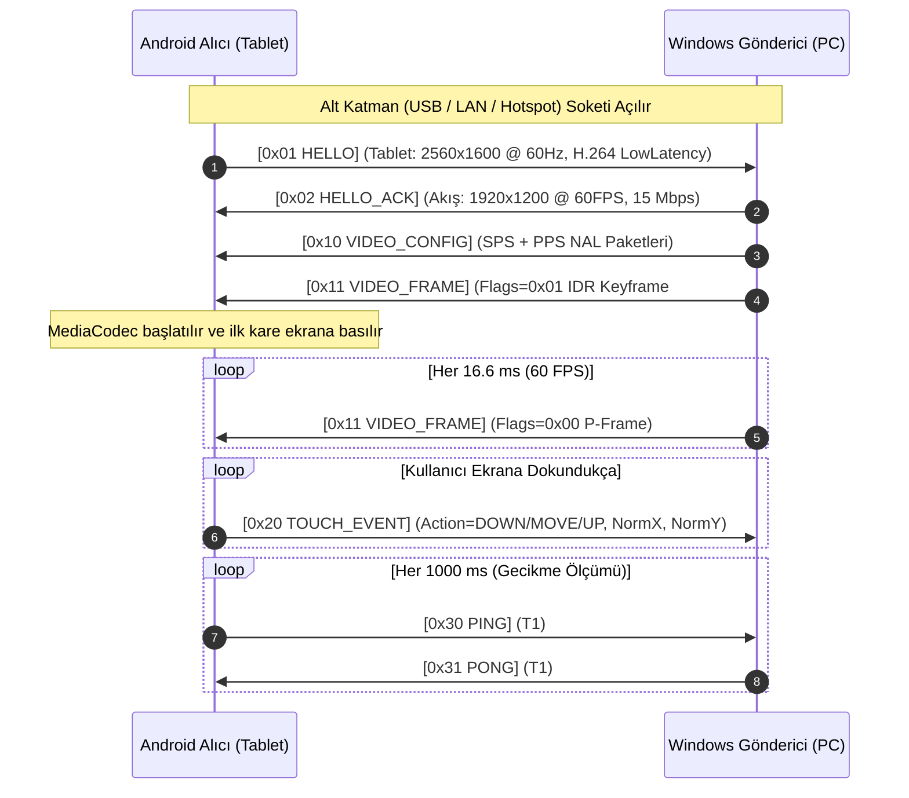

# İkinci Ekran Projesi — Haberleşme Protokolü Şartnamesi (`PROTOCOL.md`)

Bu belge, **Windows Gönderici (C#)** ile **Android Alıcı (Kotlin)** arasındaki tüm iletişimin bayt (byte) düzeyindeki kurallarını tanımlar.

> [!NOTE]
> **Taşıma Katmanından Bağımsızlık İlkesi:**
> Bu protokol; verinin **USB-C (`adb reverse`)**, **Wi-Fi LAN**, **Windows Mobil Etkin Nokta (Hotspot)** veya **Wi-Fi Direct** üzerinden taşındığını bilmez. Alt katman (`ITransport`) baytları karşı tarafa ulaştırdığı sürece bu belgedeki mesaj formatı üç bağlantı modunda da **%100 aynı** kalır.

---

## 1. Yeni Başlayanlar İçin: Neden Kendi Protokolümüzü Tanımlıyoruz?

Ağ üzerinden (TCP soketi ile) veri gönderirken yapılan en yaygın başlangıç hatası, *"Ben `Send(50000_bayt)` dediysem karşı taraf `Receive()` dediğinde tek seferde 50.000 bayt alır"* sanmaktır.

**TCP bir "mesaj" hattı değil, kesintisiz bir "su borusu" (Byte Stream) gibidir:**
- Gönderdiğiniz 50.000 baytlık bir video karesi, karşı tarafa önce `14.000`, sonra `20.000`, sonra `16.000` bayt olarak **3 parçada** gelebilir.
- Ya da tam tersine, gönderdiğiniz iki küçük dokunma paketi (`20 bayt + 20 bayt`) karşı tarafa tek seferde `40 bayt` olarak **yapışık** gelebilir.

Bunu çözmek için her mesajın başına sabit uzunlukta bir **Zarf Başlığı (Frame Header)** koyarız. Alıcı önce bu sabit başlığı okur, içindeki `"Gövde Uzunluğu (Payload Length)"` sayısına bakar ve tam o kadar bayt gelene kadar okumaya devam eder. Buna **Framing (Çerçeveleme)** denir.

---

## 2. Temel Kurallar ve Veri Tipleri

1. **Bayt Sıralaması (Endianness):** Tüm çok baytlı tam sayılar **Big-Endian (Network Byte Order)** formatında yazılır (En anlamlı bayt ilk sırada).
   - *C# tarafında:* `BinaryPrimitives.WriteUInt32BigEndian(...)`
   - *Kotlin tarafında:* `ByteBuffer.order(ByteOrder.BIG_ENDIAN)`
2. **Varsayılan Portlar:**
   - Ana Veri/Kontrol Portu (TCP): **`27183`**
   - LAN Otomatik Keşif Portu (UDP Broadcast - Aşama 3): **`27184`**
3. **Soket Ayarları:** Her iki tarafta da Nagle algoritması kapatılmalıdır (`TCP_NODELAY = true`).

### Veri Tipi Kısaltmaları
| Tip | Boyut | Açıklama |
| :--- | :--- | :--- |
| `u8` | 1 Bayt | İşaretsiz tam sayı (`0` .. `255`) |
| `u16` | 2 Bayt | İşaretsiz tam sayı (`0` .. `65.535`) |
| `u32` | 4 Bayt | İşaretsiz tam sayı (`0` .. `4.294.967.295`) |
| `u64` | 8 Bayt | İşaretsiz tam sayı (Mikrosaniye zaman damgaları için) |

---

## 3. Ortak Zarf Başlığı (Common Frame Header — 16 Bayt)

PC'den tablete veya tabletten PC'ye giden **her mesaj**, istisnasız olarak aşağıdaki **16 baytlık** başlıkla başlar:

```text
 0                   1                   2                   3
 0 1 2 3 4 5 6 7 8 9 0 1 2 3 4 5 6 7 8 9 0 1 2 3 4 5 6 7 8 9 0 1
+-+-+-+-+-+-+-+-+-+-+-+-+-+-+-+-+-+-+-+-+-+-+-+-+-+-+-+-+-+-+-+-+
|      Magic0   |     Magic1    |    Version    |    MsgType    |  0..3
+-+-+-+-+-+-+-+-+-+-+-+-+-+-+-+-+-+-+-+-+-+-+-+-+-+-+-+-+-+-+-+-+
|     Flags     |   Reserved    |            Sequence           |  4..7
+-+-+-+-+-+-+-+-+-+-+-+-+-+-+-+-+-+-+-+-+-+-+-+-+-+-+-+-+-+-+-+-+
|                         TimestampUs                           |  8..11
+-+-+-+-+-+-+-+-+-+-+-+-+-+-+-+-+-+-+-+-+-+-+-+-+-+-+-+-+-+-+-+-+
|                        PayloadLength                          | 12..15
+-+-+-+-+-+-+-+-+-+-+-+-+-+-+-+-+-+-+-+-+-+-+-+-+-+-+-+-+-+-+-+-+
|                     Payload (0 .. N Bayt)                     | 16..
+-+-+-+-+-+-+-+-+-+-+-+-+-+-+-+-+-+-+-+-+-+-+-+-+-+-+-+-+-+-+-+-+
```

| Ofset | Alan Adı | Tip | Değer / Açıklama |
| :--- | :--- | :--- | :--- |
| `0` | `Magic0` | `u8` | Sabit `0x53` (ASCII `'S'`) |
| `1` | `Magic1` | `u8` | Sabit `0x53` (ASCII `'S'`) — `"SS"` (SecondScreen) imzası. Yanlış veri/senkron kaybını anında yakalar. |
| `2` | `Version` | `u8` | Protokol sürümü. İlk sürüm için sabit **`0x01`**. |
| `3` | `MsgType` | `u8` | Mesajın türü (Aşağıdaki tabloya bakınız). |
| `4` | `Flags` | `u8` | Mesaj türüne özel bayraklar (Ör. Video karesinin Keyframe olup olmadığı). |
| `5` | `Reserved` | `u8` | İleride kullanılmak üzere ayrılmıştır. Her zaman `0x00` gönderilir. |
| `6..7` | `Sequence` | `u16` | Her gönderilen pakette `1` artan sıra numarası (`65535` sonrası `0`'a döner). Paket kaybı takibi içindir. |
| `8..11` | `TimestampUs` | `u32` | Göndericinin başlangıç anından itibaren geçen süre (**mikrosaniye** cinsinden, her ~71 dakikada sıfırlanır). |
| `12..15`| `PayloadLength`| `u32` | Başlıktan hemen sonra gelecek olan gövde (`Payload`) verisinin bayt cinsinden uzunluğu (`0` olabilir). **Güvenlik sınırı:** Maksimum `4.194.304` (4 MB). Daha büyük değer gelirse bağlantı sıfırlanır. |

### Mesaj Türleri (`MsgType`) Özeti

| Kod | Adı | Yön | Açıklama |
| :--- | :--- | :--- | :--- |
| `0x01` | `HELLO` | Tablet -> PC | Bağlantı isteği ve tabletin ekran özelliklerini bildirme |
| `0x02` | `HELLO_ACK` | PC -> Tablet | Bağlantı onayı ve seçilen video akış ayarları |
| `0x10` | `VIDEO_CONFIG` | PC -> Tablet | H.264 `SPS` ve `PPS` yapılandırma baytları |
| `0x11` | `VIDEO_FRAME` | PC -> Tablet | Sıkıştırılmış tek bir H.264 video karesi |
| `0x12` | `KEYFRAME_REQ` | Tablet -> PC | Acil I-Frame (anahtar kare) talebi |
| `0x20` | `TOUCH_EVENT` | Tablet -> PC | Tekli veya çoklu parmak dokunma verisi |
| `0x30` | `PING` | Çift Yönlü | Gecikme ölçümü ve bağlantı kontrol mesajı |
| `0x31` | `PONG` | Çift Yönlü | `PING` mesajına verilen anlık yanıt |
| `0xF0` | `ERROR` | Çift Yönlü | Hata kodu ve okunabilir hata açıklaması |
| `0xFF` | `DISCONNECT` | Çift Yönlü | Normal bağlantı kapatma bildirimi |

---

## 4. Bağlantı Yaşam Döngüsü (El Sıkışma ve Akış)



---

## 5. Mesaj Gövdeleri (Payload Formatları)

### 5.1. El Sıkışma Mesajları (`HELLO` & `HELLO_ACK`)

#### `0x01 HELLO` (Tablet -> PC, Gövde: 32 Bayt)
Soket bağlanır bağlanmaz ilk mesajı **Tablet** gönderir:

| Gövde Ofseti | Alan Adı | Tip | Açıklama |
| :--- | :--- | :--- | :--- |
| `0..1` | `NativeWidth` | `u16` | Tabletin fiziksel yatay piksel çözünürlüğü (Ör. `2560`) |
| `2..3` | `NativeHeight` | `u16` | Tabletin fiziksel dikey piksel çözünürlüğü (Ör. `1600`) |
| `4..5` | `MaxFps` | `u16` | Tabletin desteklediği yenileme hızı (`60` veya `120`) |
| `6..7` | `PreferredBitrateKbps`| `u16` | İstenen bit hızı (Kbps cinsinden, ör. `15000` = 15 Mbps) |
| `8` | `FeatureFlags` | `u8` | Bit 0: `1` = Dokunma destekliyor, Bit 1: `1` = Low-Latency Decoder var |
| `9..15` | `Reserved` | `7 bayt` | Sıfır (`0x00`) |
| `16..31` | `DeviceName` | `16 bayt`| UTF-8 cihaz adı (Ör. `"Galaxy Tab S9\0\0\0"`, kalanlar `0x00` ile doldurulur) |

#### `0x02 HELLO_ACK` (PC -> Tablet, Gövde: 16 Bayt)
PC, tabletin özelliklerine göre yakalayacağı çözünürlüğü belirler ve yanıt verir:

| Gövde Ofseti | Alan Adı | Tip | Açıklama |
| :--- | :--- | :--- | :--- |
| `0` | `Status` | `u8` | `0x00` = Kabul edildi, `0x01` = Sürüm uyumsuz, `0x02` = Encoder başlatılamadı |
| `1` | `CodecId` | `u8` | `0x01` = H.264 (AVC) |
| `2..3` | `StreamWidth` | `u16` | Gönderilecek videonun genişliği (Ör. `1920`) |
| `4..5` | `StreamHeight` | `u16` | Gönderilecek videonun yüksekliği (Ör. `1080` veya `1200`) |
| `6..7` | `TargetFps` | `u16` | Hedef kare hızı (Ör. `60`) |
| `8..11` | `BitrateBps` | `u32` | Seçilen bit hızı (bps cinsinden, ör. `15000000`) |
| `12..15` | `SessionId` | `u32` | Yeniden bağlanmalarda oturumu tanımak için rastgele üretilen numara |

---

### 5.2. Video Mesajları (`VIDEO_CONFIG`, `VIDEO_FRAME`, `KEYFRAME_REQ`)

#### `0x10 VIDEO_CONFIG` (PC -> Tablet, Gövde: Değişken ~30–100 Bayt)
İlk video karesinden önce **ve** çözünürlük her değiştiğinde gönderilir.
- İçerik: Standart **H.264 Annex-B** formatında (`0x00 0x00 0x00 0x01` başlangıç kodlu) birleştirilmiş **SPS (Sequence Parameter Set)** ve **PPS (Picture Parameter Set)** bayt dizisidir.
- Android alıcı bu paketi aldığında `MediaFormat.setByteBuffer("csd-0", ...)` olarak `MediaCodec`'e verir veya doğrudan `BUFFER_FLAG_CODEC_CONFIG` bayrağıyla çözücüye besler.

#### `0x11 VIDEO_FRAME` (PC -> Tablet, Gövde: `8 + N` Bayt)
Sıkıştırılmış tek bir H.264 karesini taşır.

**Başlık (`Header.Flags`) Bayrakları:**
- `Bit 0 (0x01)`: `1` ise bu kare **IDR / I-Frame (Anahtar Kare)**'dir. `0` ise **P-Frame (Fark Karesi)**'dir.
- `Bit 1 (0x02)`: `1` ise bu karede fare imleci görüntüye gömülüdür.

**Gövde (Payload) Yapısı:**
| Gövde Ofseti | Alan Adı | Tip | Açıklama |
| :--- | :--- | :--- | :--- |
| `0..3` | `FrameNumber` | `u32` | Akış başladığından beri üretilen video karesi sayacı |
| `4..5` | `CaptureDurationUs`| `u16` | PC'de ekranı yakalamanın sürdüğü süre (mikrosaniye — Aşama 2 ölçümü için) |
| `6..7` | `EncodeDurationUs` | `u16` | PC'de H.264 sıkıştırmanın sürdüğü süre (mikrosaniye — Aşama 2 ölçümü için) |
| `8..N` | `NalData` | `Bayt[]`| H.264 Annex-B (`00 00 00 01 ...`) sıkıştırılmış video verisi |

#### `0x12 KEYFRAME_REQ` (Tablet -> PC, Gövde: 4 Bayt)
Tablet ilk bağlandığında, arka plandan geri döndüğünde veya paket kaybı yüzünden görüntü bozulduğunda PC'den acil yeni bir **I-Frame** ister:
- `0..3` (`u32`): `LastGoodFrameNumber` (Tabletin düzgün çözebildiği son kare numarası; yoksa `0`).
- **PC Davranışı:** Bu mesajı alır almaz Media Foundation kodlayıcısına `CODECAPI_AVEncVideoForceKeyFrame = 1` komutu gönderir ve bir sonraki kareyi `IDR` olarak üretir.

---

### 5.3. Dokunma Girdisi Mesajı (`0x20 TOUCH_EVENT` — Aşama 5)

**Yön:** Tablet -> PC
**Gövde Uzunluğu:** `2 + (PointerCount * 8)` Bayt (Tek parmak için sadece **10 bayt**!).

> [!TIP]
> **Neden Piksel Değil de `0..65535` Normalize Koordinat Kullanıyoruz?**
> Tablet ekranı `2560x1600`, PC ekranı `1920x1080` olabilir. Eğer tablet doğrudan piksel gönderirse her çözünürlük değişiminde hesaplama bozulur. Bunun yerine tablet, aktif video alanının sol üst köşesini `(0, 0)`, sağ alt köşesini `(65535, 65535)` kabul ederek oranlar:
> $$\text{NormX} = \text{round}\left(\frac{X_{\text{video}}}{\text{Genişlik}_{\text{video}}} \times 65535\right)$$
> Bu sayede Windows tarafındaki `InjectTouchInput` API'si ile doğrudan ve kayıpsız eşleşir.

| Gövde Ofseti | Alan Adı | Tip | Açıklama |
| :--- | :--- | :--- | :--- |
| `0` | `PointerCount` | `u8` | Paketteki parmak sayısı (`1` .. `10`) |
| `1` | `ChangedIndex` | `u8` | Bu olayı tetikleyen parmağın dizideki indeksi |
| `2..` | `Pointers[]` | `8 Bayt x N` | Her bir aktif parmak için aşağıdaki 8 baytlık yapı tekrarlanır |

**Tek Bir Parmak Kaydı (`PointerEntry` — 8 Bayt):**
| Ofset | Alan Adı | Tip | Açıklama |
| :--- | :--- | :--- | :--- |
| `0` | `PointerId` | `u8` | Parmağın benzersiz kimliği (`0` .. `9`, parmak kalkana kadar sabit kalır) |
| `1` | `Action` | `u8` | `0x01` = `DOWN` (Dokundu)<br>`0x02` = `MOVE` (Hareket ediyor)<br>`0x03` = `UP` (Kalktı)<br>`0x04` = `CANCEL` (İptal edildi) |
| `2..3` | `NormalizedX` | `u16` | Yatay konum (`0` = En Sol, `65535` = En Sağ) |
| `4..5` | `NormalizedY` | `u16` | Dikey konum (`0` = En Üst, `65535` = En Alt) |
| `6..7` | `ContactRadius` | `u16` | Parmak temas alanı büyüklüğü (isteğe bağlı, varsayılan `0`) |

---

### 5.4. Gecikme Ölçümü Mesajları (`0x30 PING` & `0x31 PONG` — Aşama 2)

Ağ gecikmesini (Round-Trip Time / RTT) ölçmek ve bağlantının koptuğunu (Dead Peer) anlamak için kullanılır. Gövde uzunluğu **8 bayttır**:

| Gövde Ofseti | Alan Adı | Tip | Açıklama |
| :--- | :--- | :--- | :--- |
| `0..3` | `PingId` | `u32` | Ping sıra numarası |
| `4..7` | `OriginTimeUs` | `u32` | `PING`'i gönderen cihazın kendi yerel mikrosaniye saati |

- **`PONG` (`0x31`) Davranışı:** `PING` mesajını alan taraf, gövdedeki 8 baytı **hiç değiştirmeden** `0x31 PONG` başlığıyla anında geri gönderir.
- **Hesaplama:** `PING`'i gönderen taraf, `PONG` geldiği andaki saatinden `OriginTimeUs` değerini çıkarır:
  $$\text{Tek Yön Ağ Gecikmesi} \approx \frac{T_{\text{şimdi}} - \text{OriginTimeUs}}{2}$$

---

### 5.5. Hata ve Kapatma Mesajları (`0xF0 ERROR` & `0xFF DISCONNECT`)

#### `0xF0 ERROR` (Gövde: `2 + N` Bayt)
| Gövde Ofseti | Alan Adı | Tip | Açıklama |
| :--- | :--- | :--- | :--- |
| `0..1` | `ErrorCode` | `u16` | `0x0001`: Protokol sürümü uyumsuz<br>`0x0002`: Ekran yakalama hatası (GPU/Masaüstü kilitli)<br>`0x0003`: Donanımsal H.264 Encoder/Decoder hatası<br>`0x0004`: Geçersiz paket / çerçeve bozulması |
| `2..N` | `MessageUtf8` | `Bayt[]`| Kullanıcıya gösterilecek UTF-8 Türkçe hata metni |

#### `0xFF DISCONNECT` (Gövde: `1` Bayt)
- `0` (`u8`): `Reason` (`0x00` = Kullanıcı kapattı, `0x01` = Yeniden başlatılıyor).

---

## 6. Kopma, Zaman Aşımı ve Yeniden Bağlanma Kuralları

Kablosuz bağlantılar (LAN, Hotspot, Wi-Fi Direct) her an kopabilir. İki taraf da aşağıdaki kurallara uymak zorundadır:

1. **Canlılık Zaman Aşımı (Heartbeat Timeout):**
   - Her 1 saniyede bir `PING` gönderilir.
   - **3 saniye** boyunca karşı taraftan hiçbir paket (Video karesi veya `PONG`) gelmezse soket ölü kabul edilir ve kapatılır.
2. **Basılı Kalan Dokunuşların Temizlenmesi (Güvenlik Kuralı):**
   - Bağlantı koptuğu anda Windows tarafındaki `Win32TouchInjector`, o sırada ekranda basılı (`DOWN`/`MOVE`) görünen tüm parmaklar için derhal işletim sistemine `POINTER_FLAG_UP | POINTER_FLAG_CANCELED` gönderir.
3. **Otomatik Yeniden Bağlanma (Exponential Backoff):**
   - Bağlantı beklenmedik şekilde (`0xFF DISCONNECT` gelmeden) koparsa, Android alıcı sırasıyla `500 ms`, `1000 ms`, `2000 ms` (maksimum `3000 ms`) aralıklarla yeniden bağlanmayı dener.
   - Yeniden bağlandığında `HELLO` -> `HELLO_ACK` -> `VIDEO_CONFIG` -> `IDR VIDEO_FRAME` akışı baştan çalışır; böylece görüntü yarım saniye içinde kaldığı yerden temiz şekilde devam eder.

---

## 7. Video Akışı ve Bit Hızı Yönetimi

1. **Taşıma Protokolü (TCP NoDelay - Port 27183):**
   - El sıkışma (`HELLO`, `HELLO_ACK`), ayarlar (`VIDEO_CONFIG`), kurtarma (`KEYFRAME_REQ`), video akışı (`VIDEO_FRAME`), dokunmatik (`TOUCH_EVENT`) ve `PING`/`PONG` mesajları optimize edilmiş, gecikmesiz TCP (TCP_NODELAY) üzerinden akar.
2. **Ayarlanabilir Bit Hızı Sınırı:**
   - Tablet arayüzünden yayın bit hızı sınırı seçilebilir (`10`, `15`, `20`, `30`, `40` Mbps). Varsayılan değer **15 Mbps**'dir.
   - `HELLO` paketindeki `PreferredBitrateKbps` alanı vericiye iletilir ve donanımsal H.264 kodlayıcı bu sınır ile başlatılır.
3. **Anahtar Kare İsteği (IDR Recovery):**
   - Donanımsal kod çözücü referans kaybı veya bozulma tespit ettiğinde TCP üzerinden `0x12 KEYFRAME_REQ` gönderir (en fazla 500 ms'de 1 istek hız limitiyle).
   - Verici bu isteği aldığında anında tam bir `IDR` anahtar karesi üretir.
4. **Her Anahtar Karede SPS/PPS:**
   - Her IDR karesinde hem NAL akışı içerisine in-band SPS/PPS iliştirilir hem de TCP üzerinden `0x10 VIDEO_CONFIG` iletilir.
5. **Canlı Telemetri:**
   - Alıcı HUD üzerinde FPS, alınan bit hızı, donanım encode süresi, ağ RTT/2 gecikmesi, donanım decode süresi ve toplam tahmini gecikmeyi canlı olarak gösterir.

